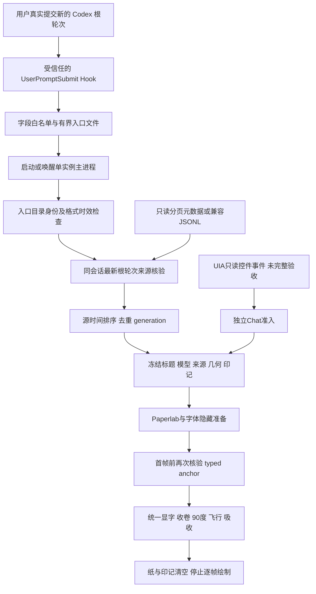

# 架构交接 · 0.6.4

审计日期：2026-10-27。本文按当前人工维护的源码说明运行合同；不把历史报告、预览或单元检查当作新机器实机验收。历史实际环境与结果以 [PUBLIC-VERIFICATION.md](PUBLIC-VERIFICATION.md) 为准，操作入口见 [INSTALL.md](../INSTALL.md)。本次交接没有修改运行时代码。

## 1. 产品与系统边界

正式路径是 **Codex 工作聊天的 UserPromptSubmit 插件 Hook → 本机 Electron 透明伴随窗口**。用户真实发送并产生新根轮次时触发；打开或切换聊天不是触发器。同轮追加、重复、过期、旧轮次及不能证明来源的输入可以被拒绝。动画表达“交付敕令”，不证明服务端接收、模型工作状态、任务成功、token、费用或完成百分比。

窗口、纸张和退场印记均由本程序生成。代码中 `pet`、`pet.html`、`petPosition` 等名称是历史命名，不是官方 Pet API。当前程序没有真实官方 Pet 位置联动，也不要求官方 Pet 开关开启。`DeliveryTargetBridge` 保留未来受支持宿主适配器的边界，正常路径没有该适配器输入。

正常主程序还启动一条 UIA 发送控件辅助观察路径；它只能准入明确的 Chat 模式，Work 模式返回 `work-association-unavailable`。这一分支未完成普通 ChatGPT 聊天的完整实机验收，不能作为正式可用声明。它与 Hook 独立，观察器失败不能取消独立核验的 Hook 展示。独立隔离预览不启动观察器或会话绑定。证据：[main.cjs](../desktop/main.cjs)、[entrance-contract.cjs](../desktop/entrance-contract.cjs)、[host-state.cjs](../desktop/host-state.cjs)。

## 2. 数据流与信任边界

Hook 文件属于本机交接数据，不是可信执行脚本，也不自证当前轮次。主进程重新构建白名单、验证物理目录和会话来源，随后才改变排队状态。渲染器不能自行声明受支持的外部 Pet 目标，不能提供任意品牌 URL、SVG 或代码。

此边界防止格式混用、陈旧事件、路径重定向及错误归属；它不是对同一用户权限下恶意进程的数字签名认证。事件 ID 是会话与轮次的 SHA256 派生标识，完整性清单也是一致性检查，均不能单独证明发布者或宿主身份。

## 3. 模块依赖与职责

| 层/入口 | 关键符号 | 输入 → 输出；主要依赖 |
|---|---|---|
| [插件 manifest](../plugin/.codex-plugin/plugin.json)、[Hook 定义](../plugin/hooks/hooks.json) | `UserPromptSubmit` | 官方 `PLUGIN_ROOT` → 外部 Node 加载本插件脚本；异步 Hook、宿主超时 2 秒；安装和 Trust 是客户端分别管理的状态 |
| [插件脚本](../plugin/scripts/user-prompt-submit.cjs) | `runStdin`、`handoff`、`createDiagnostics` | Hook stdin → `entrance-events/<eventId>.json` 与独立启动参数；依赖入口适配器和标题索引；正文丢弃，无显示文本 stdout |
| [入口适配器](../adapter/entrance-event.cjs) | `createEntranceEvent`、`validateEntranceEvent`、`readEntranceFile`、`verifyEntranceTurn`、`applyVerifiedReasoning` | 不可信对象/文件 → 有界白名单事件、核验结果、诚实的字段来源；依赖 envelope、分页兼容层 |
| [分页兼容层](../adapter/paginated-state.cjs) | `verifyPaginatedEntrance`、`verificationAnchor`、`PAGED_VERSIONS`、`SQL` | 固定元数据库 → 同会话最新根轮次、名称、可选配置努力和 typed anchor；延迟加载 `node:sqlite` |
| [标题索引](../adapter/chat-title.cjs) | `readChatTitle` | 明确 session ID + 本地 `session_index.jsonl` → 同 ID 最新合法 `thread_name` 或 pending；旧 JSONL 路径兼容使用 |
| [旧信封/Hook适配](../adapter/envelope.cjs)、[hook.cjs](../adapter/hook.cjs)、[旧交接](../adapter/hook-handoff.cjs) | `EnvelopeBridge`、`metadataFor`、`safeText`、`HookAdapter` | 旧任务状态信封 → `Session` 事件；保留开发/兼容合同，不是当前插件注册入口 |
| [旧日志适配](../adapter/rollout.cjs) | `RolloutAdapter` | 用户明确选定且版本锁定的 JSONL → 任务状态 Envelope；不是分页数据库观察 API |
| [桌面主进程](../desktop/main.cjs) | `acceptEntranceFile`、`applyEntrance`、`rendererReady`、`samePreparedVerification`、`cancelPresentation` | 单实例参数/IPC/核验结果 → 冻结展示上下文、窗口及受限快照；协调 adapter、host-state、Electron |
| [宿主纯逻辑](../desktop/host-state.cjs) | `EntranceScheduler`、`HostClock`、`verifyEntranceUntil`、`prepareLocalSealLayout`、`SendAdmissionGate`、`DeliveryTargetBridge` | 有证据事件/几何 → 排队、状态快照、布局和准入决定；本身不发现官方 Pet |
| [窗口几何](../desktop/native-window-geometry.cjs) | `ownNativeBounds`、`nativeBoundsMatch` | 原始 setBounds 请求、实际窗口、DIP 往返 → 一次性圆整收据及后续严格匹配 |
| [受限桥](../desktop/preload.cjs) | `fuHost`、`fuPreview` | 固定操作与有限快照/证据 IPC；浏览器页面没有 Node 访问能力 |
| [真实符窗控制器](../desktop/pet.js) | `update`、`render`、`invalidate` | 主进程快照 → 一代 `BurnView`；管理 ready token、RAF、静止唤醒和隐藏取消 |
| [读符页](../desktop/reader.js) | `readerStatus`、`fieldSourceExplanation` | 当前快照 → 可读字段、Hook/UIA分别诊断、字体覆盖说明；输出使用 textContent/受控SVG |
| [完整预览](../desktop/motion-preview.js) | `PreviewClock`、`PreviewDeliveryRun` | 冻结当前符或合成示例 → 同一 `BurnView`/时间线；章节暂停不等于自然连续播放验收 |
| [符面核心](../renderer/ritual-core.js) | `normalizeMetadata`、`buildTalismanSVG`、`escapeXML`、`writingProgress` | 纯字段及来源 → 确定性 SVG；文本截断、XML 编码、题辞与来源标识 |
| [展示时间线](../renderer/entrance-timeline.js) | `timings`、`frameAt`、`EntranceTimeline` | 单调时间 + 冻结计划 → 一次性阶段、纸张和印记状态；不产生任务 completed |
| [显字与材质桥](../renderer/burn-view.js) | `BurnView` | 同一符面 SVG + frame → SVG字序与 Paperlab材质分段呈现；不是额外任务时钟 |
| [Paperlab集成](../renderer/paperlab-entry.jsx)、[会话所有权](../renderer/paperlab-session.js) | `RitualPaperlab.createView`、`createSession` | 冻结 metadata → 预热纹理/材质、按调用帧绘制、受限状态与 dispose |
| [收卷引擎](../renderer/roll-preview-engine.jsx)、[卷纸参数](../renderer/roll-motion.js) | `createRollDeliveryView`、`createRollPreviewView`、`frameAt` | 同一正面纹理与实际 PaperMesh → 底部收卷、保持UV、实测枢轴、屏幕平面旋转及裁切 |
| [交付轨迹](../renderer/delivery-motion.js)、[几何](../renderer/send-geometry.js) | `createLocalSealPlan`、`localSealStillValid`、`resolveRollPivot`、`sample`、`canvasBoundsAt` | 明确几何 → 冻结滚卷/短弧飞行/固定接收平面计划；没有目标发现功能 |
| [背面](../renderer/paper-backface.js)、[裁切证据](../renderer/mesh-clip-bounds.js) | `createBackPixels`、`configureFacing`、`visibleBounds` | 本轮像素或网格 → 弱透墨背面、真实材质朝向、CPU三角形裁切范围；不截图其他窗口 |
| [品牌目录](../renderer/provider-identity.js)、[资源](../renderer/provider-assets.js)、[印记视图](../renderer/provider-seal-view.js) | `resolveProvider`、`getMark`、`createView` | 精确且来源可信的 model → 固定本地素材或通用印；Logo静止、外圈独立缓转 |
| [UIA包装](../desktop/send-observer.cjs)、[协议](../adapter/ui-send-observation.cjs)、[系统辅助脚本](../desktop/windows-send-observer.ps1) | `SendObserver`、`validateUiObservation` | 核验包/进程/窗口及明确模式的控件调用 → 有界几何与固定诊断；不读取编辑框正文、不模拟点击 |
| [卷纸独立检查器](../desktop/roll-preview-main.cjs)、[控制器](../desktop/roll-preview.js) | `start`、`validateCommand`、`RollController` | 隔离本地示例 → 色带/纸背/几何检查；不加载产品 main、Hook、会话或观察器 |

`window-target.cjs` 保留“最后记录窗口外框”的有限读取研究，正常 main 不调用它，不能以该文件推出真实 Pet 定位。`folded-paper.js` 保留旧三段折纸实现；当前入口仅复用 `inkSubpaths`，默认退场是实际卷纸。`paperlab-damage.js`、`paperlab-fire.js` 及旧燃烧工具仍可供检查，当前 Paperlab入口不导入火焰效果，不能用旧文件名推断默认烧纸。

## 4. 当前入口事件与来源核验

当前入口 JSON 与旧 [task-envelope.schema.json](../config/task-envelope.schema.json) 是两个合同。后者描述旧任务信封，含 `runId/state/source/provenance`；当前入口由 `createEntranceEvent`/`validateEntranceEvent` 的运行时代码构建，含 `turnId/kind/title/transcriptPath/createdAt` 等。不要拿旧 schema 当作当前入口的完整验证器。

| 环节 | 当前约束与失败行为 |
|---|---|
| 输入 | `runStdin` 最多 2 MiB，入口文件最多 65,536 bytes；约 1,450 ms fail-open 截止；异常静默退出0，不能阻塞模型执行 |
| 内容 | 只构造允许字段；prompt 不进入入口。model 来自当次 Hook，environment只留cwd末级名；Hook标题只是临时候选，主进程使用核验后的同会话来源 |
| 文件 | 产品用户目录及 `entrance-events` 必须是普通目录，拒绝最终符号链接；64位 dev/ino 核对真实物理所有者，兼容MSIX同目录不同路径写法；文件名必须匹配会话/轮次哈希 |
| 时效与容量 | 入口与根开始时间上限120秒，未来偏差不超过5秒；Hook清理本目录过期合法文件，限制在128个有效事件、512项目录保护；主进程不把mtime当源顺序 |
| 分页来源 | 只读 `state_5.sqlite` 与 `thread_history_1.sqlite`；检查所需列类型、主键和普通文件身份；`threads/history_mode=paginated/source=vscode`、非spawn子线程、同session/turn、root=turn、最新root及源时间均需通过 |
| 版本 | 分页线程创建版本白名单：`0.163.0-alpha.10.2`、`0.163.0-alpha.11`、`0.164.0-alpha.11.1`。不是“当前CLI够新就放行”，也不是官方稳定API |
| JSONL兼容 | 仅已核验旧版本（`SUPPORTED_CLI_VERSIONS`）；限定 sessions 内rollout文件、首条session_meta、最新主根task_started、源时间与文件读取一致性；保留真实byte offset |
| 准备前后 | `verifyEntranceUntil` 对来源未就绪等短暂状态有界重试；先正向核验，后源时间排序/去重；纹理准备完成后 `rendererReady` 再查同session/turn/start/typed anchor；不一致就不播放 |

分页查询固定于 `threads`、`thread_spawn_edges`、`thread_turns` 的必要元数据；参数化查询ID，禁止扩展加载，连接只读并设置100ms忙等待。不查询消息表、`error_json`、配置模型、凭据或任意JSON。分页 `rollout_ordinal` 只用于root排序；`sourceRevision`与身份字段产生 `codex-paginated-metadata:` 锚点，不能把ordinal塞进JSONL的offset。旧日志锚点为 `codex-rollout:`。

证据：[entrance-event.cjs](../adapter/entrance-event.cjs)、[paginated-state.cjs](../adapter/paginated-state.cjs)、[main-verification.test.cjs](../tests/main-verification.test.cjs)、[paginated-state.test.cjs](../tests/paginated-state.test.cjs)、[hook-directory.test.cjs](../tests/hook-directory.test.cjs)。

## 5. 字段来源与冻结合同

符面七处落字与数据的对应关系如下；字段核验要求见后表。

| 纸面位置 | 写入内容与来源 |
|---|---|
| 符头下服务行 | `relay`安全显示别名；缺失时为明确原创题辞，不读取凭据URL |
| 公司小章 | `company`及其来源；缺失时为题辞，题辞不证明公司身份 |
| 奉请名号 | 当次Hook报告的`model`；未取得保持unknown |
| 敕令 | 本程序固定“敕”“令”仪式文案，表达本次提交，不是任务成功证明 |
| 捆仙绳与侧文 | `harness`执行框架，以及当次cwd末级名形成的`environment`；不写完整路径 |
| 所请事项 | 同会话已验证聊天标题；纸面显示受限短标题，`fullTask`保留完整显示标题供读符，缺失为题辞，不使用prompt |
| 符胆 | `reasoning`；reported当次证据、configured配置快照分别标注，缺失或无效为unknown |

| 字段 | 可以证明什么 | 不允许的替代 |
|---|---|---|
| model | 当次UserPromptSubmit明确报告的名称 | 全局默认、线程配置模型、上轮模型 |
| title/task | 核验同会话的分页 `name`；旧路径用同ID标题索引；缺失为pending题辞 | 用户prompt、窗口标题、其他会话名称 |
| reasoning reported | 旧JSONL当前根之后、同turn且同model、无冲突的 `turn_context.effort` | Hook未报告字段、任意JSON、全局默认 |
| reasoning configured | 同会话合法 `reasoning_effort` 两读一致的配置快照；显示“配置·高”等，说明未确认当次生效 | 改标reported、以配置证明本次实际努力 |
| provider | `resolveProvider`精确目录 + reported model + 无来源冲突；品牌素材再次匹配证据字段 | 模型前缀、产品名、中转别名、任意公司字串或未经核验别名 |
| relay/company装饰 | 有证据则显示字段；缺失处明确原创题辞 | 题辞充当公司证明，未知默认OpenAI |

`applyEntrance` 强制将 `task/fullTask` 设置为标题，构造 `metadata.sources`。`EntranceTimeline.trigger`、`createSession`的调用者、纹理准备与印记视图按代冻结；后续配置/目录/标题变化不追写当前纸张。新代必须创建/准备自己的内容。运行时品牌目录在 `provider-identity.js`，`config/provider-catalog.json` 是对应审阅记录；更改应同时核对，不只改JSON。证据：[provider-handoff-regression.test.cjs](../tests/provider-handoff-regression.test.cjs)、[configured-reasoning.test.cjs](../tests/configured-reasoning.test.cjs)。

## 6. 两套时间线不能合并解释

`renderer/ritual-timeline.js` 的 `Session` 是保留的任务状态模型：默认30秒一周期，仅 `working`累计activeMs；waiting/unknown暂停，completed/error/cancelled终止；`HostClock`对睡眠及90秒陈旧证据转unknown。它经旧EnvelopeBridge/RolloutAdapter供读符/兼容用途，不能解释当前入口动画的时长。

当前 `EntranceTimeline` 是一次性发送展示，使用主进程单调时间：

| 时间/阶段 | 当前默认合同 |
|---|---|
| 0—120ms | 取纸点 |
| 120—850ms | 牵出纸张 |
| 850—1950ms | 完成舒展；仍无未来文字 |
| 1950—4150ms | 原始SVG字形按语义分组渐显；并非汉字真实笔顺数据 |
| 4150—6150ms | 全文完整阅读2秒；5950ms起临时印记出现，文字保持完整 |
| 6150ms后 | 底部向上收卷850ms；以真实卷轴枢轴在屏幕平面旋转90°，短弧飞行、暂驻、固定平面逐段吸收；实际总长取冻结布局计划 |
| 纸结束后 | 印记轻应200ms、退印200ms，全部清空 |

`timings.totalMs`不是所有布局的固定全程承诺；`hideAtMs`按交付计划计算。当前宿主的 `entranceMotionPolicy` 明确保留完整动效，记录系统 reduced-motion 偏好但 `effectiveReducedMotion=false`。纯时间线保留静态分支不能据此宣称正式宿主已自动遵守系统减弱动效。

## 7. 渲染与生命周期所有权

正常符窗与完整预览共用 `BurnView`、符面Core、入口时间线、Paperlab运行包和收卷引擎。取纸/舒展由真实PaperMesh渲染；显字/完整阅读使用锐利SVG；收卷/旋转/飞行/吸收使用同本轮完整符面的纹理和连续网格。背面采用素纸与正面墨色差在线性光中按默认0.2合成，保持纸alpha，并补偿Paperlab背采样翻转。不能用整图透明叠加伪造纸背透墨。

绘制由调用者驱动，React Three Fiber设 `frameloop: never`，Paperlab无autoplay/physics，GSAP仅暂停时间线seek且立即sleep共享ticker。控制器仅在需要动画时RAF，静止阅读可用一次唤醒；主进程250ms状态广播和证据计数不等于仍在GPU逐帧绘制。结束/隐藏清空画面，换代或dispose释放旧纹理、材质、上下文；异步旧准备即使完成也不能接管新代。正常结束可保留不可见的当前视图供状态读取，不能据此声称每轮结束立即销毁整个进程。

取消条件包括新代替换、用户隐藏、原生隐藏/最小化、pagehide、几何改变、目标失效、渲染错误、睡眠和退出。`presentationGeneration`、`entranceCancellation`、scheduler token、ready token和渲染器closed代共同阻止旧动画复活；它们有各自层级，不能只保留一个“最后接收时间”。相关检查：[paperlab.test.cjs](../tests/paperlab.test.cjs)、[roll-motion.test.cjs](../tests/roll-motion.test.cjs)、[entrance-ownership.test.cjs](../tests/entrance-ownership.test.cjs)。

## 8. 窗口、坐标与IPC

透明符窗为无边框、不聚焦、置顶、跳过任务栏、鼠标穿透的自有窗口；读符和手动预览可以由用户打开并获得焦点。Hook独立布局依据本程序保存位置及当前显示器workArea，不声称从当前发送按钮或官方Pet处出现。`prepareLocalSealLayout`尝试下/左/右和紧凑尺寸；可用区域放不下就拒绝，不猜位置。

UIA辅助脚本输出物理屏幕px，Electron只在宿主边界转换为DIP，渲染层只处理overlay-local-dip。0.6.4的 `ownNativeBounds` 仅认可本程序一次setBounds立即采样且由原请求DIP→物理→DIP证明的右/下不超过1DIP扩张，位置不变；后续move/resize必须与收据精确匹配。它不是任意1像素容差。显示器增删或指标变化取消本轮。实机只验单屏125%，混合DPI/多屏仍未测。

主窗口启用 `contextIsolation/sandbox/webSecurity`，关闭Node集成、DevTools、webview和导航/新窗口。CSP与请求过滤拒绝网络，权限请求统一拒绝；仅加载本地脚本/字体和固定data素材。preload只暴露固定方法，主进程再检查真实sender、token、枚举、数值范围和证据大小。

主要通道为 `fu:initial`、`fu:snapshot`、`fu:action`、`fu:renderer-ready`、`fu:renderer-invalidated`、`fu:render-evidence`；完整预览使用 `fu:preview-initial/evidence/command`。外部入口只经附着参数 `--entrance-file=<file>`交给产品单实例；重复/歧义参数拒绝。没有HTTP服务、MCP监听端口、模型调用或远程CDN。不要为复用这些内部IPC而接入未公开宿主管道。

## 9. 本地存储与隐私

| 数据 | 读写与保留边界 |
|---|---|
| 产品用户数据目录 | `%APPDATA%/summoning-fu-handoff`；Hook与正常实例共享；不是官方Codex认证目录 |
| `entrance-events/*.json` | 包含本地会话/轮次ID、模型、同会话标题候选、环境末级名、transcript路径等必要元数据；不含prompt。Hook按TTL清理，不能将其公开当匿名数据 |
| `summoning-fu-settings.json` | 本程序位置及可选手动binding；写临时文件后rename；`petPosition`只是本程序位置；不更新官方Pet/Trust/认证 |
| `hook-stages.jsonl` | 固定stage/reason、时刻、字节数、布尔值；有界轮换约64KiB；不是原始stdin日志 |
| `entrance-status.json` | 准入阶段、固定原因、时刻和计数；received/queued/applied是不同阶段，计数不证明用户看见全程 |
| 显示别名 | 可选本地 `display-aliases.json`；公司需要证据字段，relay禁止URL/路径；不要复制个人文件进发布包 |
| 明确启用的diagnostics/capture | 命令行指定位置后才写遥测/自有窗口截图；原始诊断可含本地身份、屏幕几何、哈希等，截图可含真实标题，不随公开材料分发 |
| 隔离预览 | 独立profile只用合成示例；正常托盘完整预览可能冻结当前真实符，需要按真实内容保护 |

权限模式请求为目录0700、交接/设置等文件0600；Windows实际访问控制取决于用户目录ACL，不能把POSIX模式数字当作已验证WindowsACL。

**保留代码的隐私差别必须明说：** 当前插件入口丢弃正文，分页源重验只读固定元数据列。旧手动 `RolloutAdapter` 会解析用户明确选择的JSONL里UserMessage文本，生成旧信封，再由 `applyEntrance`以标题替换展示task/fullTask；旧 `sanitizeHook`也保留有界净化prompt。它们不是当前插件注册的正常入口，但不能笼统说整个仓库所有路径都“不读取正文”。未经单独授权，不用这些兼容入口做真实聊天排错。

## 10. 构建与修改影响

[build-paperlab.cjs](../scripts/build-paperlab.cjs)从 `paperlab-entry.jsx` 打包锁定本地依赖与字体到 `renderer/generated/paperlab-runtime.js`；该大文件为产物，不能手工修补。完整离线HTML由 [build-preview.cjs](../scripts/build-preview.cjs)复用同一markup/controller生成。桌面包包含Electron和本地源码/资源，插件包再加入市场根、manifest、Hook和桌面runtime；[package-plugin.cjs](../scripts/package-plugin.cjs)检查版本及内含源码逐字节一致，拒绝陈旧桌面包。公开快照与私有完整开发树的打包文档清单有所区别，修改时以所处树脚本为准。

| 修改位置 | 必须联动检查的风险 |
|---|---|
| Hook/入口文件协议 | stdin有界、正文丢弃、静默fail-open、目录身份、启动参数、同轮去重；修改Hook定义可能需用户重新Trust |
| 分页/JSONL兼容层 | 明确版本证据、同session/root/latest/time、只读固定列、typed anchor、准备前重验；不能为演示放宽白名单 |
| 新字段/来源 | envelope到sources转换、unknown回退、Core/reader说明、长度和XML编码；reported与configured语义不可合并 |
| 品牌目录/资源 | 运行时代码目录、JSON审阅记录、完整证据匹配、通用回退、素材来源和品牌条件 |
| 时间线/收卷/材质 | 正常与预览一致、2秒阅读、0.2背面、90°、固定平面逐段吸收、结束清空；不加第二套自主时钟 |
| 几何/显示器 | 原请求DIP证明、后续严格失效、布局不越workArea、隐藏取消；需要对应实机条件验收 |
| preload/IPC/观察器 | sender与所有权、字段白名单、字节限制、有限重试、无正文/全局输入采集，Hook不受UIA失败牵连 |
| 发布/依赖 | 锁文件与第三方许可、版本/源码一致、个人配置及QA排除、INTEGRITY；不改UNLICENSED，不自动发布 |

具体变更决策见 [DECISIONS.md](DECISIONS.md)，尚未解决或未验收项见 [KNOWN_ISSUES.md](KNOWN_ISSUES.md)。
